# Mise en place d'une API Gateway avec Spring Cloud

**Atelier :** Implémentation « API Gateway » – Applications Web Distribuées
**Étudiant :** Jihed Khlifi
**Projet :** JobBoard (microservices Candidat, Job, Candidature, Meeting, Notification)

L'API Gateway est le **point d'entrée unique** de l'architecture : les clients n'appellent plus chaque microservice
sur son propre port, mais uniquement la Gateway (`http://localhost:8090`), qui transmet chaque requête au bon service
selon son chemin.

---

## Sommaire

1. [Architecture](#1-architecture)
2. [Partie 1 – Création du projet](#2-partie-1--création-du-projet)
3. [Partie 2 – Configuration statique](#3-partie-2--configuration-statique)
4. [Partie 3 – Configuration dynamique avec Eureka](#4-partie-3--configuration-dynamique-avec-eureka)
5. [Question 2.b – Algorithme de load balancing](#5-question-2b--algorithme-de-load-balancing)
6. [Question 3 – Algorithme Random pour le service candidat](#6-question-3--algorithme-random-pour-le-service-candidat)
7. [Statique ou dynamique ?](#7-statique-ou-dynamique-)
8. [Lancement](#8-lancement)

---

## 1. Architecture

| Composant | Port(s) | Nom dans Eureka | Chemin via la Gateway |
|---|---|---|---|
| Eureka Server | 8761 | – | – |
| **API Gateway** | **8090** | API-GATEWAY | – |
| Candidat | 8081, 8091 | CANDIDAT | `/mic1/**` |
| Job | 8082 | JOB | `/api/jobs/**`, `/api/categories/**` |
| Candidature | 8085, 8095 | CANDIDATURE | `/mic3/candidature/**` |
| Meeting (Node.js) | 8083 | MEETING | `/api/meetings/**` |
| Notification (Python) | 8084 | NOTIFICATION | `/api/notifications/**` |

```
Client ──► API Gateway :8090 ──► (Eureka :8761 : « où est candidature ? »)
                │
                ├── /mic1/**              ──► Candidat     (8081 | 8091)
                ├── /api/jobs/**          ──► Job          (8082)
                ├── /mic3/candidature/**  ──► Candidature  (8085 | 8095)
                ├── /api/meetings/**      ──► Meeting      (8083)
                └── /api/notifications/** ──► Notification (8084)
```

La Gateway tourne sur le port **8090** : le port 8085 utilisé dans le cours est déjà pris par le microservice Candidature.

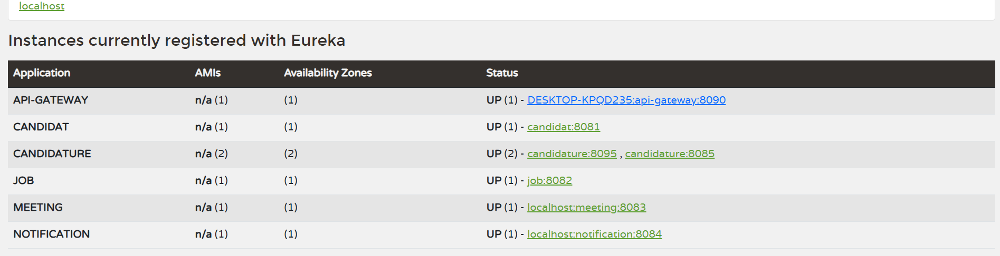

---

## 2. Partie 1 – Création du projet

Projet Spring Boot `api-gateway` (Spring Boot 4.2, Spring Cloud 2026.0) avec les starters **Gateway** et
**Eureka Discovery Client** :

```xml
<dependency>
    <groupId>org.springframework.cloud</groupId>
    <artifactId>spring-cloud-starter-gateway-server-webflux</artifactId>
</dependency>
<dependency>
    <groupId>org.springframework.cloud</groupId>
    <artifactId>spring-cloud-starter-netflix-eureka-client</artifactId>
</dependency>
<dependency>
    <groupId>org.springframework.boot</groupId>
    <artifactId>spring-boot-starter-actuator</artifactId>
</dependency>
```

Remarques sur les versions (cf. chapitre 5 du cours) :
- depuis Spring Cloud 2025.0, `spring-cloud-starter-gateway` s'appelle **`spring-cloud-starter-gateway-server-webflux`**,
  et les propriétés passent de `spring.cloud.gateway.*` à **`spring.cloud.gateway.server.webflux.*`** ;
- `@EnableEurekaClient` n'existe plus : on utilise **`@EnableDiscoveryClient`** ;
- avec Spring Boot 4, le client Eureka a besoin de `spring-boot-starter-actuator`.

```java
@SpringBootApplication
@EnableDiscoveryClient
public class ApiGatewayApplication {
    public static void main(String[] args) {
        SpringApplication.run(ApiGatewayApplication.class, args);
    }
}
```

---

## 3. Partie 2 – Configuration statique

Les routes sont déclarées dans `application.properties` (méthode 2), avec l'**adresse exacte** de chaque
microservice. Eureka n'intervient pas.

```properties
spring.application.name=api-gateway
server.port=8090

spring.cloud.gateway.server.webflux.routes[0].id=CANDIDAT
spring.cloud.gateway.server.webflux.routes[0].uri=http://localhost:8081
spring.cloud.gateway.server.webflux.routes[0].predicates[0]=Path=/mic1/**

spring.cloud.gateway.server.webflux.routes[1].id=JOB
spring.cloud.gateway.server.webflux.routes[1].uri=http://localhost:8082
spring.cloud.gateway.server.webflux.routes[1].predicates[0]=Path=/api/jobs/**,/api/categories/**

spring.cloud.gateway.server.webflux.routes[2].id=CANDIDATURE
spring.cloud.gateway.server.webflux.routes[2].uri=http://localhost:8085
spring.cloud.gateway.server.webflux.routes[2].predicates[0]=Path=/mic3/candidature/**

spring.cloud.gateway.server.webflux.routes[3].id=MEETING
spring.cloud.gateway.server.webflux.routes[3].uri=http://localhost:8083
spring.cloud.gateway.server.webflux.routes[3].predicates[0]=Path=/api/meetings/**

spring.cloud.gateway.server.webflux.routes[4].id=NOTIFICATION
spring.cloud.gateway.server.webflux.routes[4].uri=http://localhost:8084
spring.cloud.gateway.server.webflux.routes[4].predicates[0]=Path=/api/notifications/**
```

Chaque route est composée d'un **id**, d'un **prédicat** (`Path=...`, le chemin qui déclenche la route)
et d'une **URI** (l'adresse du microservice).

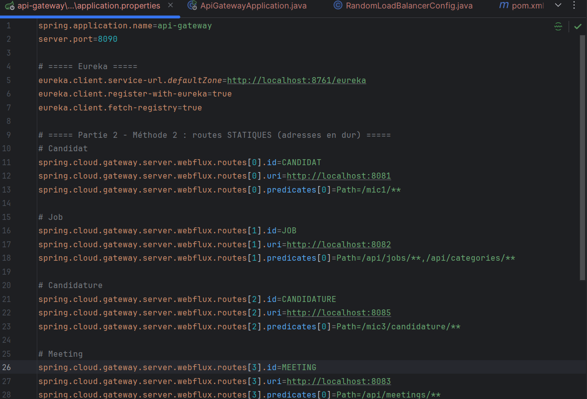
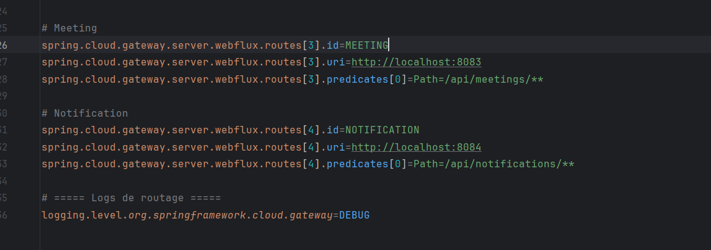

### Tests d'accès via la Gateway (statique)

| Requête | Service atteint | Capture |
|---|---|---|
| `GET http://localhost:8090/mic1/candidates` | Candidat | 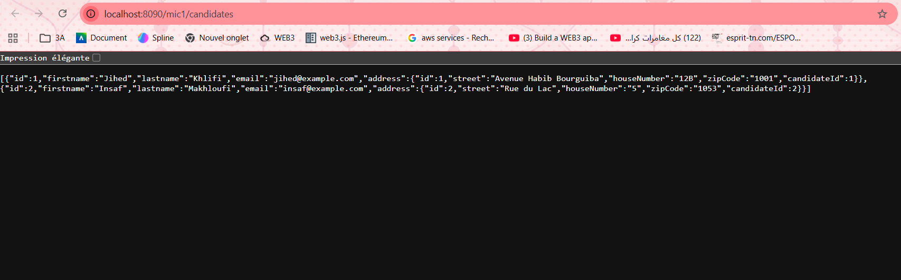 |
| `GET http://localhost:8090/api/jobs` | Job | 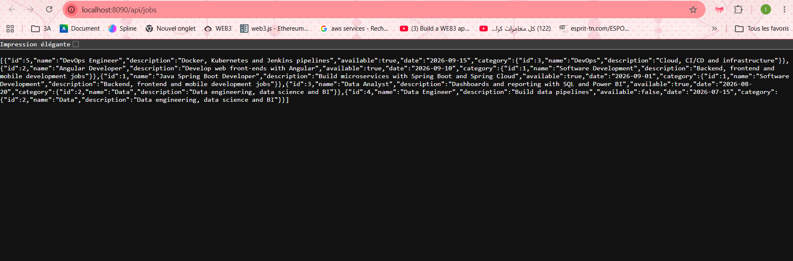 |
| `GET http://localhost:8090/mic3/candidature/hello` | Candidature | 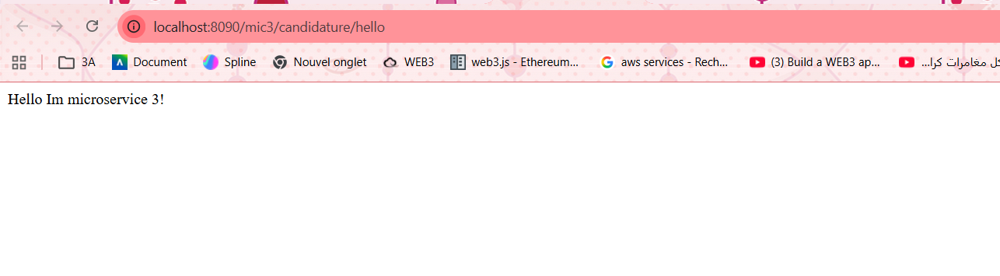 |
| `GET http://localhost:8090/api/meetings/hello` | Meeting | 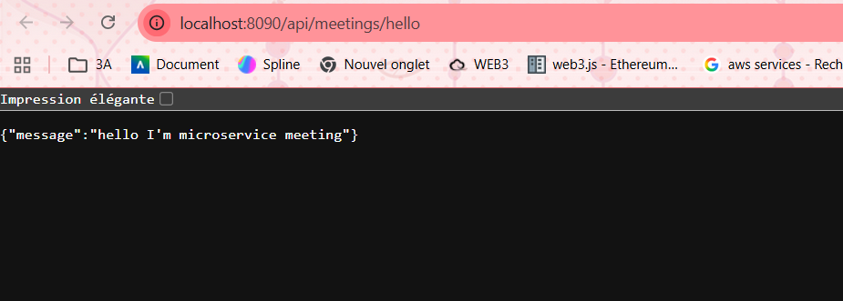 |
| `GET http://localhost:8090/api/notifications/hello` | Notification | 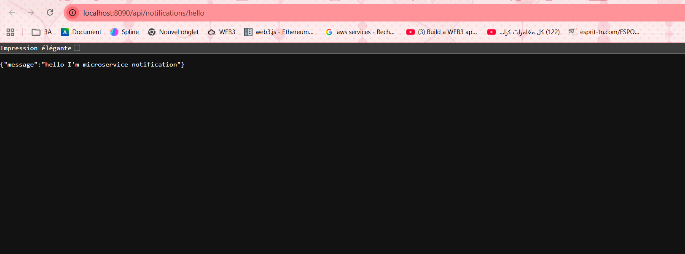 |

Les candidats ont été créés en `POST` **à travers la Gateway** (`POST http://localhost:8090/mic1/candidates`).

---

## 4. Partie 3 – Configuration dynamique avec Eureka

Seule l'URI change : l'adresse écrite en dur est remplacée par **`lb://nom-du-service`**. La Gateway demande à
**Eureka** où se trouve le service, et le **LoadBalancer** choisit une instance.

```properties
eureka.client.service-url.defaultZone=http://localhost:8761/eureka
eureka.client.register-with-eureka=true
eureka.client.fetch-registry=true   # indispensable pour résoudre lb://

spring.cloud.gateway.server.webflux.routes[0].id=CANDIDAT
spring.cloud.gateway.server.webflux.routes[0].uri=lb://candidat
spring.cloud.gateway.server.webflux.routes[0].predicates[0]=Path=/mic1/**

spring.cloud.gateway.server.webflux.routes[1].id=JOB
spring.cloud.gateway.server.webflux.routes[1].uri=lb://job
spring.cloud.gateway.server.webflux.routes[1].predicates[0]=Path=/api/jobs/**,/api/categories/**

spring.cloud.gateway.server.webflux.routes[2].id=CANDIDATURE
spring.cloud.gateway.server.webflux.routes[2].uri=lb://candidature
spring.cloud.gateway.server.webflux.routes[2].predicates[0]=Path=/mic3/candidature/**

spring.cloud.gateway.server.webflux.routes[3].id=MEETING
spring.cloud.gateway.server.webflux.routes[3].uri=lb://meeting
spring.cloud.gateway.server.webflux.routes[3].predicates[0]=Path=/api/meetings/**

spring.cloud.gateway.server.webflux.routes[4].id=NOTIFICATION
spring.cloud.gateway.server.webflux.routes[4].uri=lb://notification
spring.cloud.gateway.server.webflux.routes[4].predicates[0]=Path=/api/notifications/**
```

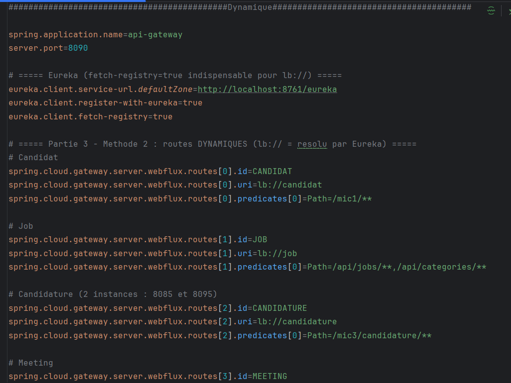
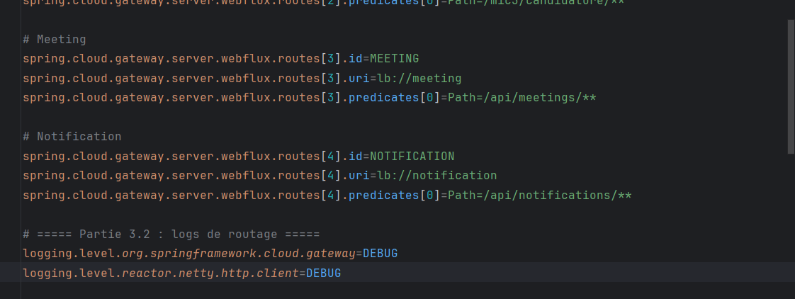

### Tests d'accès via la Gateway (dynamique)

Les URL appelées par le client **ne changent pas** : seule la façon dont la Gateway trouve le service change.

| Requête | Service atteint | Capture |
|---|---|---|
| `GET http://localhost:8090/mic1/candidates` | Candidat | 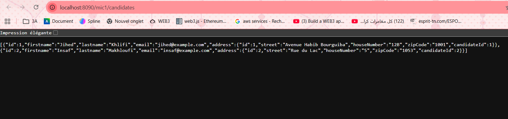 |
| `GET http://localhost:8090/api/jobs` | Job | 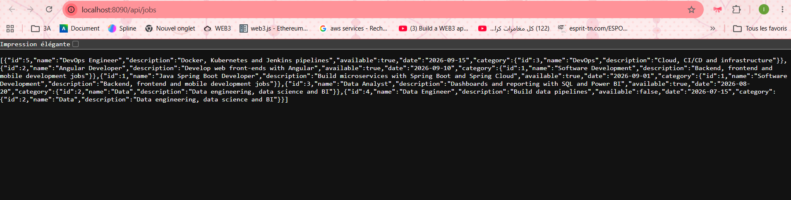 |
| `GET http://localhost:8090/mic3/candidature/hello` | Candidature | 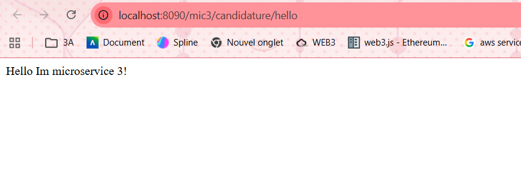 |
| `GET http://localhost:8090/api/meetings/hello` | Meeting | 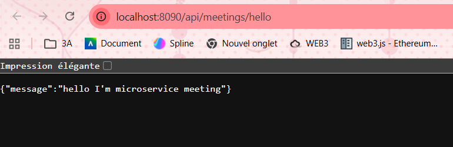 |
| `GET http://localhost:8090/api/notifications/hello` | Notification | 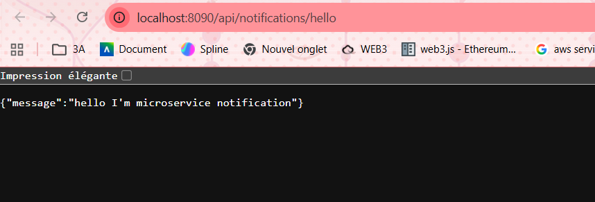 |

---

## 5. Question 2.b – Algorithme de load balancing

**Activation des logs de routage** (`application.properties`) :

```properties
logging.level.org.springframework.cloud.gateway=DEBUG
logging.level.reactor.netty.http.client=DEBUG
logging.level.org.springframework.cloud.gateway.filter.ReactiveLoadBalancerClientFilter=TRACE
```

**Test :** deux instances de Candidature sont lancées (ports **8085** et **8095**, la 2ᵉ avec
`-Dserver.port=8095`), puis la requête `http://localhost:8090/mic3/candidature/hello` est envoyée 9 fois.

Pour chaque requête, la console de la Gateway affiche :
- `url before: lb://candidature/mic3/candidature/hello` : la route contient le **nom logique** du service ;
- `url chosen: http://192.168.135.1:80XX/mic3/candidature/hello` : l'**instance réelle** choisie à partir du registre Eureka.

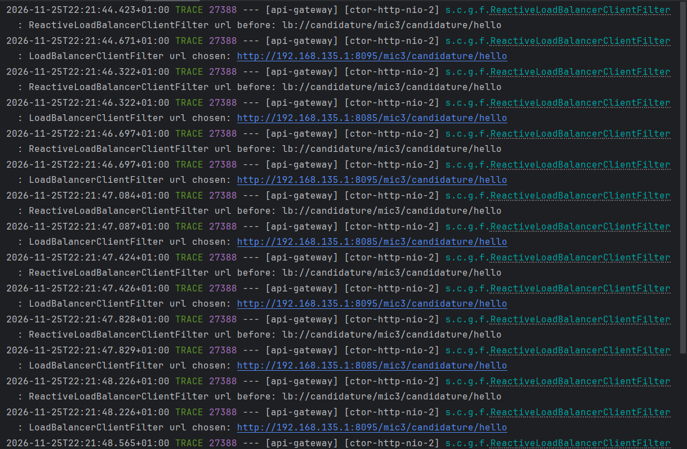
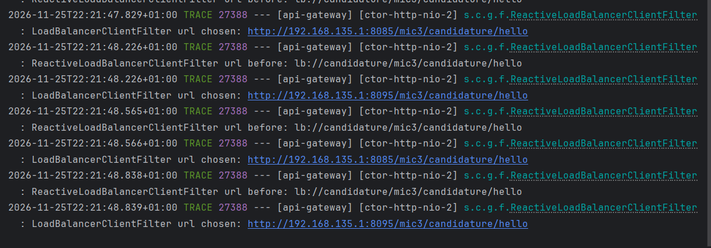

**Réponse :** les instances choisies sont, dans l'ordre :
**8095 → 8085 → 8095 → 8085 → 8095 → 8085 → 8095 → 8085 → 8095**.
Elles sont sollicitées **à tour de rôle**, de façon régulière : l'algorithme utilisé par défaut est le
**Round Robin** (`RoundRobinLoadBalancer` de Spring Cloud LoadBalancer).

---

## 6. Question 3 – Algorithme Random pour le service candidat

### Types de load balancing

| Stratégie | Principe |
|---|---|
| **Round Robin** (par défaut) | les instances sont choisies à tour de rôle |
| **Random** | une instance est tirée au hasard à chaque requête |
| **Weighted Response Time** | favorise les instances qui répondent le plus vite |
| **Zone Avoidance** | privilégie les instances de la même zone de disponibilité |

### Configuration de Random, uniquement pour `candidat`

`RandomLoadBalancerConfig.java`, **sans** `@Configuration` (sinon Random s'appliquerait à tous les services) :

```java
public class RandomLoadBalancerConfig {

    @Bean
    public ReactorLoadBalancer<ServiceInstance> randomLoadBalancer(Environment environment,
                                                                   LoadBalancerClientFactory factory) {
        String serviceId = environment.getProperty(LoadBalancerClientFactory.PROPERTY_NAME);
        return new RandomLoadBalancer(
                factory.getLazyProvider(serviceId, ServiceInstanceListSupplier.class), serviceId);
    }
}
```

`ApiGatewayApplication.java` :

```java
@SpringBootApplication
@EnableDiscoveryClient
@LoadBalancerClient(name = "candidat", configuration = RandomLoadBalancerConfig.class)
public class ApiGatewayApplication { ... }
```

### Test

Deux instances de Candidat sont lancées (ports **8081** et **8091**) :

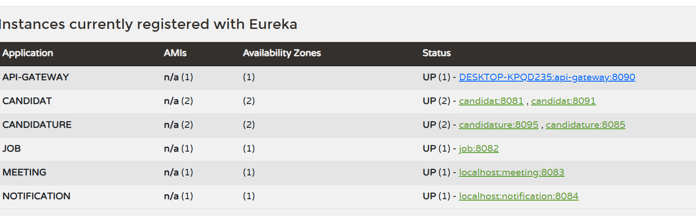

Après plusieurs appels à `http://localhost:8090/mic1/candidates`, les logs montrent l'instance **8091 choisie trois
fois de suite** :

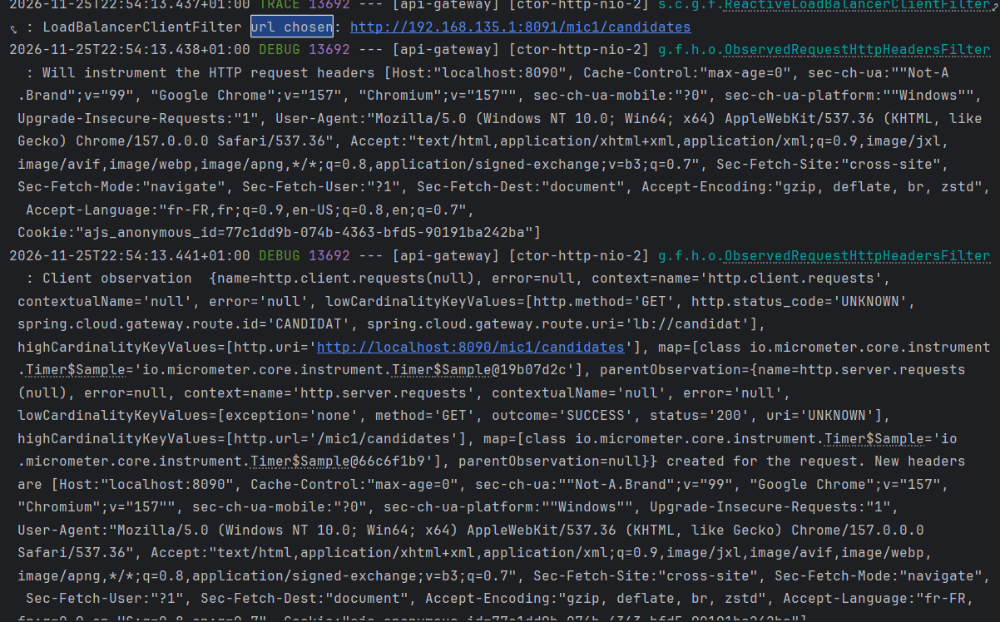
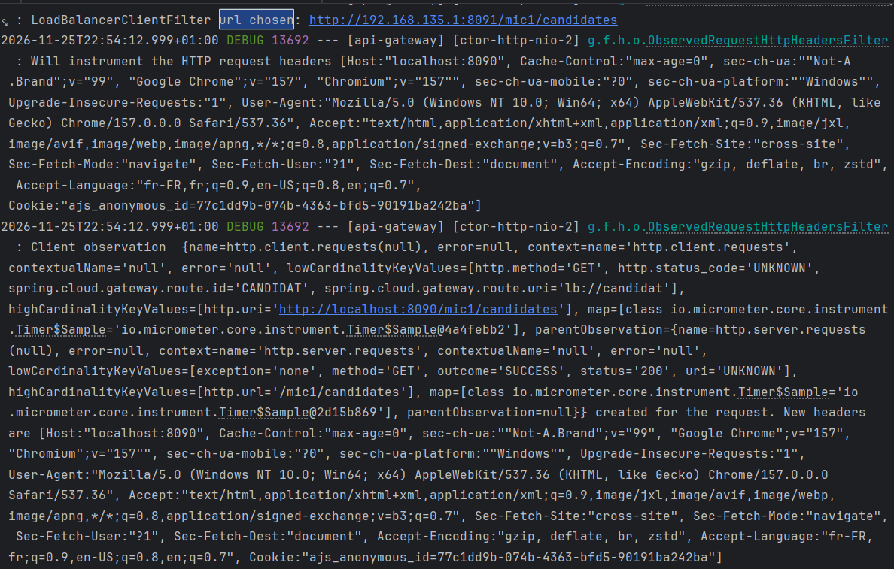
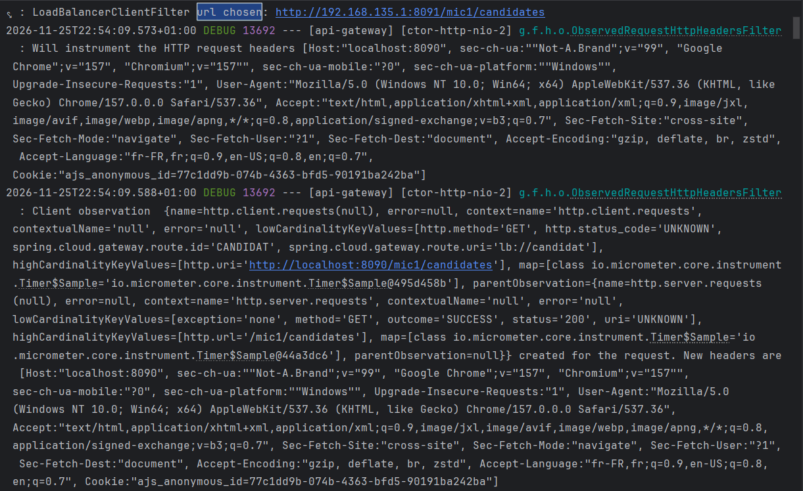

**Réponse :** avec le Round Robin, les instances auraient alterné (8081, 8091, 8081…). Le choix est donc bien
**aléatoire** pour Candidat. Le service Candidature, lui, garde le **Round Robin** : le Random ne s'applique
**qu'au service candidat**.

---

## 7. Statique ou dynamique ?

| Critère | Statique `http://localhost:8085` | Dynamique `lb://candidature` |
|---|---|---|
| Utilise Eureka | Non | Oui |
| Adresse du service | figée dans la Gateway | résolue à chaque requête |
| Plusieurs instances | une seule utilisée | load balancing automatique |
| Une instance tombe / change de port | la Gateway ne trouve plus le service | transparent |
| Avantage | simple, fonctionne sans Eureka | adapté à la production et au cloud |
| Inconvénient | à modifier à chaque changement d'adresse | dépend d'Eureka, délai de découverte initial |

---

## 8. Lancement

Ordre : **MySQL** (XAMPP, pour Job) → **Eureka** → **microservices** → **API Gateway**.

| Service | Commande |
|---|---|
| Eureka, Candidat, Job, Candidature | IntelliJ ▶ (2ᵉ instance : VM options `-Dserver.port=8091` / `8095`) |
| Meeting | `cd backend/microservices/meeting` puis `npm start` |
| Notification | `cd backend/microservices/notification`, `.\venv\Scripts\Activate.ps1` puis `python -m app.main` |
| API Gateway | IntelliJ ▶ `ApiGatewayApplication` → http://localhost:8090 |

Vérification : http://localhost:8761 doit afficher **API-GATEWAY** et tous les microservices **UP**.
